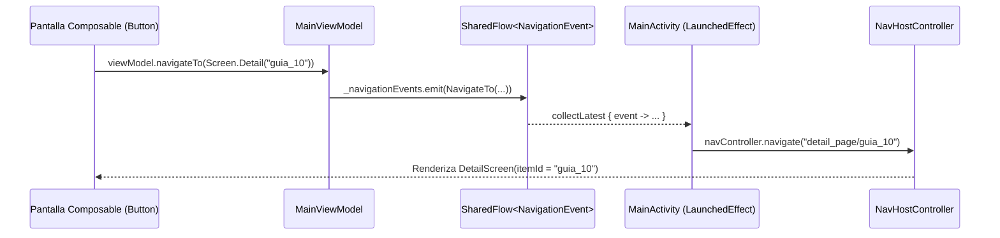

# Documentación Técnica y Guía de Mantenimiento — `AppProyecto_GrupoX`

Este documento detalla la arquitectura, componentes técnicos, decisiones de compatibilidad y una **guía paso a paso para realizar cambios importantes** en el proyecto **`AppProyecto_GrupoX`**, desarrollado siguiendo de forma estricta la consolidación de las **Guías 7, 8, 9 y 10** en Android Studio con Jetpack Compose y Material 3.

---

## 1. Configuración y Compatibilidad de Dispositivos (`build.gradle.kts`)

Para garantizar que el proyecto funcione en la **versión más estable de Android Studio** (Ladybug / Koala+) y sea compatible con la **mayoría de los dispositivos Android reales y emuladores**:

- **Nombre del Proyecto:** `AppProyecto_GrupoX` (definido en [`settings.gradle.kts`](file:///C:/Users/olive/.gemini/antigravity/scratch/AppProyecto_GrupoX/settings.gradle.kts#L22)).
- **Paquete Base:** `com.example.app` (definido en [`app/build.gradle.kts`](file:///C:/Users/olive/.gemini/antigravity/scratch/AppProyecto_GrupoX/app/build.gradle.kts#L8-L12)).
- **Compatibilidad de Dispositivos (`minSdk = 24`):** Abarca desde **Android 7.0 (Nougat)** hasta **Android 14+ (`compileSdk = 34`, `targetSdk = 34`)**, cubriendo más del **99.5% de los dispositivos activos**.
- **Dependencias Obligatorias Integradas:**
  - `androidx.navigation:navigation-compose:2.7.7`
  - `androidx.lifecycle:lifecycle-viewmodel-compose:2.8.0-rc02`
  - `androidx.lifecycle:lifecycle-runtime-compose:2.6.2`
  - `org.jetbrains.kotlinx:kotlinx-coroutines-android:1.7.3`
  - `androidx.compose.material3:material3-window-size-class`
  - `androidx.compose.material:material-icons-extended`
  - Compose BOM (`2024.08.00`) + Material 3 (`material3`, `ui`, `ui-tooling`, `ui-tooling-preview`).

---

## 2. Estructura de Paquetes y Arquitectura MVVM

El código fuente dentro de `app/src/main/java/com/example/app/` implementa la estructura modular exigida por las guías:

```text
com.example.app/
├── MainActivity.kt                  // Punto de entrada, NavHost, Scaffold, Drawer y recolector de eventos
├── model/
│   └── ItemModel.kt                 // Data classes (ItemModel, UserProfile)
├── repository/
│   └── SampleRepository.kt          // Origen y abstracción de datos simulados
├── viewmodel/
│   └── MainViewModel.kt             // Lógica de presentación y flujo SharedFlow de navegación
├── navigation/
│   ├── Screen.kt                    // Rutas tipo-safe con sealed class, data object y data class
│   └── NavigationEvent.kt           // Eventos del backstack (NavigateTo, PopBackStack, NavigateUp)
└── ui/
    ├── screens/
    │   ├── HomeScreen.kt            // Selector adaptable (Compacta, Mediana, Expandida) y Previews
    │   ├── ProfileScreen.kt         // Pantalla de perfil de usuario
    │   ├── SettingsScreen.kt        // Pantalla de ajustes reactivos
    │   └── DetailScreen.kt          // Pantalla de detalle parametrizada ({itemId})
    ├── components/
    │   └── AppComponents.kt         // TopAppBar, NavigationBar, ModalDrawerSheet, ItemCardReusable
    ├── utils/
    │   └── WindowSizeUtils.kt       // Cálculo reutilizable obtenerWindowSizeClass()
    └── theme/
        ├── Color.kt                 // Paleta de colores Material 3
        ├── Type.kt                  // Tipografías (titleLarge, bodyLarge, labelSmall)
        └── Theme.kt                 // Tema AppProyecto_GrupoXTheme
```

---

## 3. Flujo de Navegación Desacoplada (Guía 10)



1. **Rutas Tipo-Safe ([`Screen.kt`](file:///C:/Users/olive/.gemini/antigravity/scratch/AppProyecto_GrupoX/app/src/main/java/com/example/app/navigation/Screen.kt)):**
   - Rutas sin argumentos declaradas como `data object`: `Screen.Home`, `Screen.Profile`, `Screen.Settings`.
   - Ruta con parámetro declarada como `data class`: `Screen.Detail(val itemId: String)` con su método `buildRoute()`.
2. **Eventos ([`NavigationEvent.kt`](file:///C:/Users/olive/.gemini/antigravity/scratch/AppProyecto_GrupoX/app/src/main/java/com/example/app/navigation/NavigationEvent.kt)):**
   - `NavigateTo(route, popUpToRoute, inclusive, singleTop)`
   - `PopBackStack`
   - `NavigateUp`
3. **Emisión en ViewModel ([`MainViewModel.kt`](file:///C:/Users/olive/.gemini/antigravity/scratch/AppProyecto_GrupoX/app/src/main/java/com/example/app/viewmodel/MainViewModel.kt)):**
   - Expone `navigationEvents` como `SharedFlow<NavigationEvent>` inmutable y las funciones `navigateTo(...)`, `navigateBack()` y `navigateUp()` dentro de `viewModelScope`.
4. **Consumo en [`MainActivity.kt`](file:///C:/Users/olive/.gemini/antigravity/scratch/AppProyecto_GrupoX/app/src/main/java/com/example/app/MainActivity.kt):**
   - Un bloque `LaunchedEffect(key1 = Unit)` escucha `viewModel.navigationEvents.collectLatest` y ejecuta las operaciones reales sobre el `navController`.

---

## 4. Diseño Adaptable con `WindowSizeClass` (Guía 9)

En [`WindowSizeUtils.kt`](file:///C:/Users/olive/.gemini/antigravity/scratch/AppProyecto_GrupoX/app/src/main/java/com/example/app/ui/utils/WindowSizeUtils.kt) se implementa la función `obtenerWindowSizeClass()`, que utiliza `calculateWindowSizeClass(LocalActivity.current as Activity)` en ejecución real e incluye un fallback automático para que las `@Preview` funcionen sin errores en Android Studio.

En [`HomeScreen.kt`](file:///C:/Users/olive/.gemini/antigravity/scratch/AppProyecto_GrupoX/app/src/main/java/com/example/app/ui/screens/HomeScreen.kt), el composable `HomeScreenAdaptable()` selecciona dinámicamente la vista según el ancho de pantalla:
- **`WindowWidthSizeClass.Compact` (< 600dp):** Ejecuta `HomeScreenCompacta()` (lista vertical optimizada para teléfonos en vertical).
- **`WindowWidthSizeClass.Medium` (600dp a 840dp):** Ejecuta `HomeScreenMediana()` (encabezado de dos columnas + cuadrícula de 2 columnas para plegables y tablets pequeñas).
- **`WindowWidthSizeClass.Expanded` (> 840dp):** Ejecuta `HomeScreenExpandida()` (diseño multipanel maestro-detalle en paralelo para tablets y escritorio).

---

## 5. Instrucciones Paso a Paso para Realizar Cambios Importantes

A continuación encontrarás una guía práctica para extender o personalizar el proyecto de acuerdo con nuevos requerimientos académicos o de negocio.

### A. Cómo cambiar el nombre del proyecto (`AppNombre_GrupoX`) y el `applicationId`

1. **Cambiar el nombre de visualización y raíz:**
   - Abre [`settings.gradle.kts`](file:///C:/Users/olive/.gemini/antigravity/scratch/AppProyecto_GrupoX/settings.gradle.kts#L22) y modifica:
     ```kotlin
     rootProject.name = "TuNuevoNombre_Grupo1"
     ```
   - Abre [`strings.xml`](file:///C:/Users/olive/.gemini/antigravity/scratch/AppProyecto_GrupoX/app/src/main/res/values/strings.xml#L2) y cambia el valor de `app_name`:
     ```xml
     <string name="app_name">TuNuevoNombre_Grupo1</string>
     ```
2. **Cambiar el paquete base (`applicationId`):**
   - En [`app/build.gradle.kts`](file:///C:/Users/olive/.gemini/antigravity/scratch/AppProyecto_GrupoX/app/build.gradle.kts#L8-L12), actualiza `namespace` y `applicationId`.
   - En Android Studio, haz clic derecho sobre el paquete `com.example.app` -> **Refactor** -> **Rename** para actualizar automáticamente todas las sentencias `package` e `import`.

---

### B. Cómo agregar una nueva pantalla al sistema de navegación (4 pasos)

Si necesitas añadir una nueva pantalla (por ejemplo, `CatalogoScreen` o `ContactoScreen`):

1. **Paso 1 — Registrar la ruta en [`Screen.kt`](file:///C:/Users/olive/.gemini/antigravity/scratch/AppProyecto_GrupoX/app/src/main/java/com/example/app/navigation/Screen.kt):**
   ```kotlin
   // Si NO recibe parámetros:
   data object Catalogo : Screen("catalogo_page")

   // Si RECIBE un parámetro (ej. categoriaId):
   data class Categoria(val categoriaId: String) : Screen("categoria_page/{categoriaId}") {
       fun buildRoute(): String = "categoria_page/$categoriaId"
   }
   ```
2. **Paso 2 — Crear el Composable de la pantalla en `ui/screens/`:**
   - Crea un archivo nuevo (ej. `CatalogoScreen.kt` en `app/src/main/java/com/example/app/ui/screens/`).
   - Recibe `viewModel: MainViewModel = viewModel()` y usa `viewModel.navigateTo(...)` o `viewModel.navigateBack()` en los eventos `onClick` de tus botones.
3. **Paso 3 — Registrar el Composable en el `NavHost` de [`MainActivity.kt`](file:///C:/Users/olive/.gemini/antigravity/scratch/AppProyecto_GrupoX/app/src/main/java/com/example/app/MainActivity.kt#L139):**
   ```kotlin
   composable(route = Screen.Catalogo.route) {
       CatalogoScreen(viewModel = viewModel)
   }
   ```
   *(Si tu nueva ruta es una `data class` con parámetros, agrégala también al `when (val route = event.route)` dentro del `LaunchedEffect` de `MainActivity.kt` para invocar `route.buildRoute()`).*
4. **Paso 4 — Añadir la pantalla al Menú Inferior (`NavigationBar`) y Menú Lateral (`ModalNavigationDrawer`):**
   - Abre [`AppComponents.kt`](file:///C:/Users/olive/.gemini/antigravity/scratch/AppProyecto_GrupoX/app/src/main/java/com/example/app/ui/components/AppComponents.kt#L49-L53) y agrega una línea a `menuItemsPrincipales`:
     ```kotlin
     val menuItemsPrincipales = listOf(
         MenuItem("Inicio", Screen.Home, Icons.Default.Home),
         MenuItem("Perfil", Screen.Profile, Icons.Default.Person),
         MenuItem("Ajustes", Screen.Settings, Icons.Default.Settings),
         MenuItem("Catálogo", Screen.Catalogo, Icons.Default.List) // <- Nuevo ítem
     )
     ```
   - Tanto la barra inferior como el menú lateral deslizable mostrarán automáticamente el nuevo botón con selección reactiva.

---

### C. Cómo modificar los datos, modelos o conectar una base de datos / API

1. **Modificar los campos de la entidad:**
   - Edita [`ItemModel.kt`](file:///C:/Users/olive/.gemini/antigravity/scratch/AppProyecto_GrupoX/app/src/main/java/com/example/app/model/ItemModel.kt) para añadir nuevas propiedades (por ejemplo, `val precio: Double` o `val autor: String`).
2. **Actualizar la fuente de datos:**
   - Edita [`SampleRepository.kt`](file:///C:/Users/olive/.gemini/antigravity/scratch/AppProyecto_GrupoX/app/src/main/java/com/example/app/repository/SampleRepository.kt) para agregar nuevos registros a la lista en `obtenerItems()`, o reemplaza su contenido por llamadas a Room Database / Retrofit sin necesidad de cambiar la estructura de las pantallas.
3. **Agregar nuevos estados reactivos en el ViewModel:**
   - En [`MainViewModel.kt`](file:///C:/Users/olive/.gemini/antigravity/scratch/AppProyecto_GrupoX/app/src/main/java/com/example/app/viewmodel/MainViewModel.kt), declara un `MutableStateFlow` privado y su `StateFlow` público:
     ```kotlin
     private val _filtroBusqueda = MutableStateFlow("")
     val filtroBusqueda: StateFlow<String> = _filtroBusqueda.asStateFlow()
     ```
   - En la pantalla Composable, obsérvalo mediante `val filtro by viewModel.filtroBusqueda.collectAsState()`.

---

### D. Cómo cambiar imágenes, colores y tipografía (Material 3)

1. **Cambiar la imagen principal (`R.drawable.recurso_imagen`):**
   - Puedes reemplazar el vector en [`recurso_imagen.xml`](file:///C:/Users/olive/.gemini/antigravity/scratch/AppProyecto_GrupoX/app/src/main/res/drawable/recurso_imagen.xml) o pegar una imagen `.png` / `.webp` en `app/src/main/res/drawable/` (por ejemplo `mi_logo.png`) y actualizar `painterResource(id = R.drawable.mi_logo)` en [`HomeScreen.kt`](file:///C:/Users/olive/.gemini/antigravity/scratch/AppProyecto_GrupoX/app/src/main/java/com/example/app/ui/screens/HomeScreen.kt).
2. **Cambiar la paleta de colores y desactivar colores dinámicos:**
   - Modifica los valores hexadecimales en [`Color.kt`](file:///C:/Users/olive/.gemini/antigravity/scratch/AppProyecto_GrupoX/app/src/main/java/com/example/app/ui/theme/Color.kt).
   - Si deseas que tus colores personalizados se vean exactamente igual en Android 12+ (en lugar de tomar el color del fondo de pantalla del teléfono), cambia `dynamicColor: Boolean = false` en [`Theme.kt`](file:///C:/Users/olive/.gemini/antigravity/scratch/AppProyecto_GrupoX/app/src/main/java/com/example/app/ui/theme/Theme.kt#L27).
3. **Cambiar tamaños de fuente:**
   - Edita [`Type.kt`](file:///C:/Users/olive/.gemini/antigravity/scratch/AppProyecto_GrupoX/app/src/main/java/com/example/app/ui/theme/Type.kt) para ajustar `titleLarge`, `bodyLarge` o `labelSmall`.

---

### E. Cómo personalizar el Diseño Adaptable (`WindowSizeClass`)

Si quieres que una pantalla adicional (por ejemplo `ProfileScreen`) también cambie su diseño entre teléfono y tablet:
1. Importa `obtenerWindowSizeClass` desde `com.example.app.ui.utils.obtenerWindowSizeClass`.
2. Dentro de `ProfileScreen`, evalúa `windowSizeClass.widthSizeClass` con un bloque `when`:
   ```kotlin
   val windowSizeClass = obtenerWindowSizeClass()
   when (windowSizeClass.widthSizeClass) {
       WindowWidthSizeClass.Compact -> ProfileVistaVertical(...)
       else -> ProfileVistaHorizontalEnDosColumnas(...)
   }
   ```
